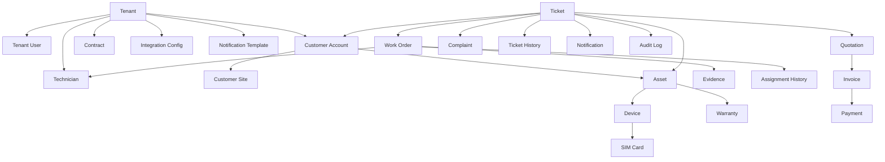
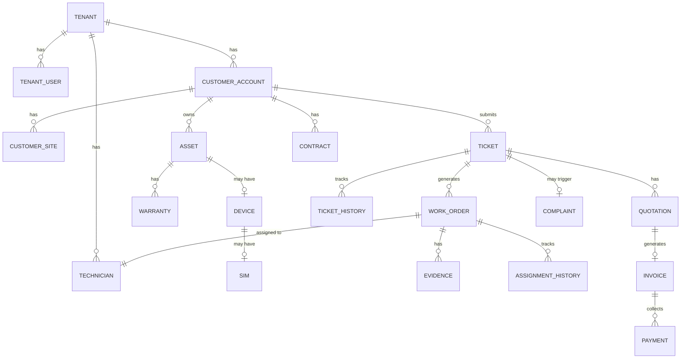
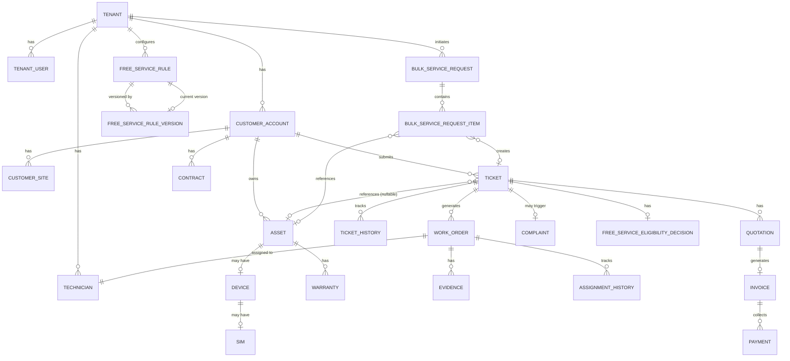

# CareOS — Domain Model

**Version:** 1.0.0-draft  
**Status:** Approved for Implementation  
**Last Updated:** 2026-11-14

---

## 1. Domain Overview

---

## 2. Domain Descriptions

### 2.1 Tenant

**Owner:** Platform Admin  
**Tenant Boundary:** This IS the boundary — every other entity belongs to a tenant.

| Field | Type | Notes |
|---|---|---|
| `id` | UUID | PK |
| `slug` | text | URL slug, unique platform-wide |
| `name` | text | Display name |
| `status` | enum | `active`, `suspended`, `trial`, `cancelled` |
| `plan` | text | Billing plan identifier |
| `settings` | jsonb | Branding, SLA defaults, numbering config, language, timezone |
| `created_at` | timestamptz | |

**Key Relationships:**
- 1 Tenant → N Tenant Users
- 1 Tenant → N Customer Accounts
- 1 Tenant → N Technicians
- 1 Tenant → N Tickets (via Customer Accounts)

**Visibility:** Tenant record itself is not customer-visible. Settings (branding) are exposed to portals via a public endpoint.

---

### 2.2 Tenant User

**Owner:** Tenant Admin  
**Tenant Boundary:** Yes — users are scoped to one tenant.

| Field | Type | Notes |
|---|---|---|
| `id` | UUID | PK; linked to `auth.users` |
| `tenant_id` | UUID | FK → tenants |
| `email` | text | |
| `full_name` | text | |
| `role` | enum | See `USER_ROLES_AND_PORTALS.md` |
| `is_active` | boolean | Soft-disabled without deleting auth record |
| `mfa_enabled` | boolean | Tracked for compliance |
| `created_at` | timestamptz | |

**Visibility:** Internal only; not visible to customers.

---

### 2.3 Customer Account

**Owner:** Tenant (CSR creates; customer can self-register)  
**Tenant Boundary:** Yes.

| Field | Type | Notes |
|---|---|---|
| `id` | UUID | PK |
| `tenant_id` | UUID | FK → tenants |
| `account_type` | enum | `individual`, `company` |
| `name` | text | Person name or company name |
| `email` | text | Primary contact email |
| `phone` | text | Normalised E.164 |
| `auth_user_id` | UUID | FK → auth.users (nullable until portal activation) |
| `is_active` | boolean | |
| `created_at` | timestamptz | |

**Key Relationships:**
- 1 Customer Account → N Customer Sites (company type only)
- 1 Customer Account → N Assets
- 1 Customer Account → N Tickets

**Visibility:** Customer can see their own account data. CSR/Dispatcher can see all within tenant.

---

### 2.4 Customer Site

**Owner:** Customer Account (company type) or CSR  
**Tenant Boundary:** Yes.

| Field | Type | Notes |
|---|---|---|
| `id` | UUID | PK |
| `tenant_id` | UUID | FK → tenants |
| `customer_account_id` | UUID | FK → customer_accounts |
| `name` | text | Site/branch name |
| `address_line1` | text | |
| `address_line2` | text | Optional |
| `city` | text | |
| `region` | text | |
| `country` | text | ISO 3166-1 alpha-2 |
| `postal_code` | text | |
| `coordinates` | point | Lat/lng (nullable) |
| `contact_name` | text | On-site contact |
| `contact_phone` | text | |
| `is_active` | boolean | |

**Visibility:** Customer account admin can see all sites. Members see their assigned site(s).

---

### 2.5 Asset

**Owner:** Customer Account (registered by CSR or customer)  
**Tenant Boundary:** Yes.

| Field | Type | Notes |
|---|---|---|
| `id` | UUID | PK |
| `tenant_id` | UUID | FK → tenants |
| `customer_account_id` | UUID | FK → customer_accounts |
| `customer_site_id` | UUID | FK → customer_sites (nullable for individual) |
| `category` | text | e.g., `hvac`, `refrigeration`, `washing_machine` |
| `make` | text | Manufacturer |
| `model` | text | Model name/number |
| `serial_number` | text | Unique within tenant |
| `purchase_date` | date | Nullable |
| `installation_date` | date | Nullable |
| `notes` | text | |
| `is_active` | boolean | |
| `created_at` | timestamptz | |

**Visibility:** Customer can view own assets. CSR/Tech can view all within tenant.

---

### 2.6 Device

**Owner:** Tenant (provisioned by technician or CSR)  
**Tenant Boundary:** Yes.

| Field | Type | Notes |
|---|---|---|
| `id` | UUID | PK |
| `tenant_id` | UUID | FK → tenants |
| `asset_id` | UUID | FK → assets |
| `device_type` | text | e.g., `control_board`, `iot_gateway` |
| `manufacturer` | text | |
| `model` | text | |
| `firmware_version` | text | |
| `mac_address` | text | Nullable |
| `imei` | text | Nullable |
| `status` | enum | `active`, `inactive`, `faulty`, `decommissioned` |
| `installed_at` | timestamptz | |

**Visibility:** Internal (ops/tech) only; not directly visible in customer portal.

---

### 2.7 SIM Card

**Owner:** Tenant  
**Tenant Boundary:** Yes.

| Field | Type | Notes |
|---|---|---|
| `id` | UUID | PK |
| `tenant_id` | UUID | FK → tenants |
| `device_id` | UUID | FK → devices (nullable — SIM can be unassigned) |
| `iccid` | text | Unique; SIM card identifier |
| `msisdn` | text | Phone number assigned to SIM |
| `carrier` | text | Network carrier name |
| `data_plan` | text | Plan identifier |
| `status` | enum | `active`, `suspended`, `deactivated`, `unassigned` |
| `activated_at` | timestamptz | |
| `expires_at` | timestamptz | Plan expiry |

**Visibility:** Internal only.

---

### 2.8 Warranty

**Owner:** Tenant (recorded by CSR or at asset registration)  
**Tenant Boundary:** Yes.

| Field | Type | Notes |
|---|---|---|
| `id` | UUID | PK |
| `tenant_id` | UUID | FK → tenants |
| `asset_id` | UUID | FK → assets |
| `warranty_type` | enum | `manufacturer`, `extended`, `service_contract` |
| `provider` | text | Warranty provider name |
| `reference_number` | text | Warranty certificate/claim number |
| `starts_at` | date | |
| `expires_at` | date | |
| `covers_parts` | boolean | |
| `covers_labour` | boolean | |
| `terms_document_url` | text | Supabase Storage URL |
| `status` | enum | `active`, `expired`, `void` |

**Visibility:** Customer can view own asset warranties (read-only). CSR can create/edit.

---

### 2.9 Ticket

**Owner:** Customer Account (self-service) or CSR (on behalf)  
**Tenant Boundary:** Yes.

| Field | Type | Notes |
|---|---|---|
| `id` | UUID | PK |
| `tenant_id` | UUID | FK → tenants |
| `ticket_number` | text | Generated, unique within tenant |
| `customer_account_id` | UUID | FK → customer_accounts |
| `customer_site_id` | UUID | FK → customer_sites (nullable) |
| `asset_id` | UUID | FK → assets (nullable — can be unknown) |
| `status` | enum | Full state machine — see `SERVICE_LIFECYCLE_AND_STATUS_MODEL.md` |
| `category` | text | Asset category / problem type |
| `description` | text | Customer-provided description |
| `priority` | enum | `low`, `normal`, `high`, `critical` |
| `coverage_type` | enum | `warranty`, `contract`, `free`, `paid`, `pending_review` |
| `warranty_id` | UUID | FK → warranties (nullable) |
| `contract_id` | UUID | FK → contracts (nullable) |
| `source` | enum | `customer_portal`, `csr_created`, `api_integration` |
| `created_by` | UUID | FK → auth.users |
| `assigned_dispatcher_id` | UUID | FK → tenant_users (nullable) |
| `sla_response_deadline` | timestamptz | Computed on triage |
| `sla_resolution_deadline` | timestamptz | Computed on triage |
| `sla_paused_at` | timestamptz | Nullable |
| `sla_paused_duration_seconds` | integer | Accumulates pause time |
| `resolved_at` | timestamptz | |
| `closed_at` | timestamptz | |
| `reopen_window_expires_at` | timestamptz | |
| `created_at` | timestamptz | |
| `updated_at` | timestamptz | |

**Visibility:** Customer sees own tickets. All ops roles see all tickets within tenant.

---

### 2.10 Ticket History

**Owner:** System (append-only, immutable)  
**Tenant Boundary:** Yes.

| Field | Type | Notes |
|---|---|---|
| `id` | UUID | PK |
| `tenant_id` | UUID | |
| `ticket_id` | UUID | FK → tickets |
| `from_status` | text | Nullable (first entry) |
| `to_status` | text | |
| `actor_id` | UUID | FK → auth.users |
| `actor_role` | text | Snapshot of role at time of action |
| `comment` | text | Optional |
| `occurred_at` | timestamptz | |
| `metadata` | jsonb | Additional context |

**Visibility:** Ops roles see full history. Customer sees status-change events only (not internal comments).

---

### 2.11 Work Order

**Owner:** Dispatcher  
**Tenant Boundary:** Yes.

| Field | Type | Notes |
|---|---|---|
| `id` | UUID | PK |
| `tenant_id` | UUID | FK → tenants |
| `work_order_number` | text | Generated |
| `ticket_id` | UUID | FK → tickets |
| `technician_id` | UUID | FK → technicians |
| `status` | enum | `pending`, `accepted`, `en_route`, `on_site`, `completed`, `incomplete`, `cancelled` |
| `scheduled_date` | date | |
| `scheduled_window_start` | time | Appointment window |
| `scheduled_window_end` | time | |
| `checkin_time` | timestamptz | Actual arrival |
| `checkout_time` | timestamptz | Actual departure |
| `work_description` | text | Technician's work notes |
| `parts_used` | jsonb | Array of `{part_code, description, qty, unit_cost}` |
| `labour_minutes` | integer | |
| `customer_signature_url` | text | Supabase Storage URL |
| `is_billable` | boolean | Derived from ticket coverage |
| `created_at` | timestamptz | |
| `updated_at` | timestamptz | |

**Visibility:** Technicians see own WOs (+ senior techs see all). Ops sees all.

---

### 2.12 Assignment History

**Owner:** System (append-only)  
**Tenant Boundary:** Yes.

| Field | Type | Notes |
|---|---|---|
| `id` | UUID | PK |
| `tenant_id` | UUID | |
| `work_order_id` | UUID | FK → work_orders |
| `technician_id` | UUID | FK → technicians |
| `assigned_by` | UUID | FK → auth.users |
| `assigned_at` | timestamptz | |
| `unassigned_at` | timestamptz | Nullable (still active if null) |
| `reason` | text | Why reassigned |

**Visibility:** Internal (ops) only.

---

### 2.13 Evidence

**Owner:** Technician (uploaded during/after work order)  
**Tenant Boundary:** Yes.

| Field | Type | Notes |
|---|---|---|
| `id` | UUID | PK |
| `tenant_id` | UUID | FK → tenants |
| `work_order_id` | UUID | FK → work_orders |
| `uploaded_by` | UUID | FK → auth.users |
| `evidence_type` | enum | `photo`, `video`, `document`, `signature` |
| `storage_path` | text | Supabase Storage path |
| `file_name` | text | |
| `file_size_bytes` | integer | |
| `mime_type` | text | |
| `caption` | text | Optional |
| `taken_at` | timestamptz | |
| `uploaded_at` | timestamptz | |

**Visibility:** Internal (ops/tech). Specific evidence items can be shared with customer (flag: `is_customer_visible`).

---

### 2.14 Quotation

**Owner:** Billing Agent / Tenant Manager  
**Tenant Boundary:** Yes.

| Field | Type | Notes |
|---|---|---|
| `id` | UUID | PK |
| `tenant_id` | UUID | FK → tenants |
| `quotation_number` | text | Generated |
| `ticket_id` | UUID | FK → tickets |
| `status` | enum | `draft`, `sent`, `approved`, `rejected`, `expired`, `invoiced` |
| `line_items` | jsonb | Array of `{description, qty, unit_price, total}` |
| `subtotal` | numeric | |
| `tax_amount` | numeric | |
| `tax_rate` | numeric | |
| `total_amount` | numeric | |
| `currency` | text | ISO 4217 (tenant-configured) |
| `valid_until` | timestamptz | TTL |
| `sent_at` | timestamptz | |
| `customer_approved_at` | timestamptz | |
| `customer_rejected_at` | timestamptz | |
| `approved_by_customer_id` | UUID | FK → auth.users |
| `notes` | text | |
| `created_by` | UUID | FK → auth.users |
| `created_at` | timestamptz | |

**Visibility:** Customer sees sent/approved/rejected/expired quotations for own tickets.

---

### 2.15 Invoice

**Owner:** System (auto-generated from approved quotation)  
**Tenant Boundary:** Yes.

| Field | Type | Notes |
|---|---|---|
| `id` | UUID | PK |
| `tenant_id` | UUID | FK → tenants |
| `invoice_number` | text | Generated |
| `quotation_id` | UUID | FK → quotations |
| `ticket_id` | UUID | FK → tickets |
| `customer_account_id` | UUID | FK → customer_accounts |
| `status` | enum | `issued`, `partially_paid`, `paid`, `void` |
| `total_amount` | numeric | |
| `amount_paid` | numeric | (v1: 0 or full — no partial) |
| `currency` | text | |
| `due_date` | date | |
| `issued_at` | timestamptz | |
| `paid_at` | timestamptz | |

**Visibility:** Customer can view own invoices.

---

### 2.16 Payment

**Owner:** System (recorded from payment gateway webhook or manual entry)  
**Tenant Boundary:** Yes.

| Field | Type | Notes |
|---|---|---|
| `id` | UUID | PK |
| `tenant_id` | UUID | FK → tenants |
| `invoice_id` | UUID | FK → invoices |
| `method` | enum | `cash`, `card_online`, `card_terminal`, `bank_transfer` |
| `amount` | numeric | |
| `currency` | text | |
| `gateway_reference` | text | Payment gateway transaction ID |
| `collected_by` | UUID | FK → auth.users (nullable for online) |
| `status` | enum | `pending`, `confirmed`, `failed`, `refunded` |
| `recorded_at` | timestamptz | |
| `confirmed_at` | timestamptz | |

**Visibility:** Customer can view own payments.

---

### 2.17 Technician

**Owner:** Tenant Admin  
**Tenant Boundary:** Yes.

| Field | Type | Notes |
|---|---|---|
| `id` | UUID | PK |
| `tenant_id` | UUID | FK → tenants |
| `auth_user_id` | UUID | FK → auth.users |
| `employee_id` | text | Internal HR reference |
| `full_name` | text | |
| `email` | text | |
| `phone` | text | |
| `skill_codes` | text[] | e.g., `['hvac','refrigeration']` |
| `home_zone_postcode` | text | Fallback location for dispatch |
| `is_active` | boolean | |
| `hire_date` | date | |
| `avg_rating` | numeric | Computed field (maintained by worker) |

**Visibility:** Internal only. Customer does not see technician personal details (name shown after assignment, phone on request by tenant config).

---

### 2.18 Contract

**Owner:** Billing Agent / Tenant Manager  
**Tenant Boundary:** Yes.

| Field | Type | Notes |
|---|---|---|
| `id` | UUID | PK |
| `tenant_id` | UUID | FK → tenants |
| `customer_account_id` | UUID | FK → customer_accounts |
| `contract_number` | text | |
| `name` | text | Contract plan name |
| `covers_categories` | text[] | Asset categories covered |
| `includes_parts` | boolean | |
| `includes_labour` | boolean | |
| `free_visits_per_year` | integer | Nullable |
| `starts_at` | date | |
| `expires_at` | date | |
| `status` | enum | `draft`, `active`, `expired`, `terminated` |
| `document_url` | text | Supabase Storage |
| `terms` | jsonb | Structured coverage terms |
| `monthly_fee` | numeric | |
| `currency` | text | |
| `signed_at` | timestamptz | |
| `signed_by_customer_id` | UUID | |

**Visibility:** Customer account admin can view their contracts.

---

### 2.19 Complaint

**Owner:** Customer or CSR  
**Tenant Boundary:** Yes.

| Field | Type | Notes |
|---|---|---|
| `id` | UUID | PK |
| `tenant_id` | UUID | FK → tenants |
| `complaint_number` | text | Generated |
| `customer_account_id` | UUID | FK → customer_accounts |
| `ticket_id` | UUID | FK → tickets (nullable) |
| `work_order_id` | UUID | FK → work_orders (nullable) |
| `type` | enum | `service_quality`, `billing`, `technician_behaviour`, `delay`, `other` |
| `description` | text | |
| `status` | enum | `open`, `under_review`, `resolved`, `escalated` |
| `assigned_to` | UUID | FK → tenant_users (nullable) |
| `resolution_notes` | text | |
| `created_by` | UUID | FK → auth.users |
| `source` | enum | `customer_portal`, `csr_created`, `phone` |
| `resolved_at` | timestamptz | |
| `created_at` | timestamptz | |

**Visibility:** Customer can view/create own complaints. CSR can manage.

---

### 2.20 Integration

**Owner:** Tenant Admin  
**Tenant Boundary:** Yes.

| Field | Type | Notes |
|---|---|---|
| `id` | UUID | PK |
| `tenant_id` | UUID | FK → tenants |
| `type` | enum | `erp`, `sms_gateway`, `email_provider`, `payment_gateway`, `webhook` |
| `name` | text | Display name |
| `adapter` | text | Connector adapter identifier |
| `config` | jsonb | Encrypted at rest; connection params |
| `is_active` | boolean | |
| `last_sync_at` | timestamptz | |
| `last_error` | text | |

**Visibility:** Internal (tenant admin) only. Config credentials never returned in API responses.

---

### 2.21 Notification

**Owner:** System (worker-generated)  
**Tenant Boundary:** Yes.

| Field | Type | Notes |
|---|---|---|
| `id` | UUID | PK |
| `tenant_id` | UUID | FK → tenants |
| `recipient_id` | UUID | FK → auth.users |
| `channel` | enum | `email`, `sms`, `in_app`, `push` |
| `event_type` | text | e.g., `ticket_created`, `technician_assigned` |
| `status` | enum | `queued`, `sent`, `delivered`, `failed` |
| `subject` | text | |
| `body` | text | |
| `sent_at` | timestamptz | |
| `delivered_at` | timestamptz | |
| `metadata` | jsonb | Reference IDs, gateway response |

**Visibility:** In-app notifications visible to recipient. Email/SMS logs internal only.

---

### 2.22 Audit Log

**Owner:** System (immutable)  
**Tenant Boundary:** Yes (platform audit log is separate).

| Field | Type | Notes |
|---|---|---|
| `id` | UUID | PK |
| `tenant_id` | UUID | FK → tenants (nullable for platform-level) |
| `actor_id` | UUID | FK → auth.users |
| `actor_role` | text | Snapshot |
| `action` | text | e.g., `ticket.status_changed`, `user.created` |
| `entity_type` | text | |
| `entity_id` | UUID | |
| `before_state` | jsonb | Nullable |
| `after_state` | jsonb | Nullable |
| `ip_address` | inet | |
| `user_agent` | text | |
| `occurred_at` | timestamptz | |

**Visibility:** Internal (tenant admin, platform admin). Never writable by any role.

---

## 3. Entity Relationship Diagram (Simplified)

---

## 4. Additions: OQ-09 and OQ-10 Resolutions (2026-11-14)

### 4.1 FreeServiceRule Domain

**Owner:** Tenant Admin / Tenant Manager  
**Tenant Boundary:** Yes.

The free-service rule entity has two layers:
- **`free_service_rules`** — master record (name, enabled state, priority, pointer to current approved version)
- **`free_service_rule_versions`** — immutable version snapshots; only an `approved` version is active; previous versions move to `superseded`

Eligibility decisions for individual tickets are stored in `free_service_eligibility_decisions` (append-only audit of what the coverage engine decided and why).

**Visibility:** Internal (tenant admin, manager) for rule configuration. The _result_ of eligibility (eligible/not, explanation) is visible to CSRs and dispatchers on the ticket.

---

### 4.2 BulkServiceRequest Domain

**Owner:** CSR / Tenant Manager / Tenant Admin  
**Tenant Boundary:** Yes.

A `BulkServiceRequest` is a **creation batch** that generates one `Ticket` per item. After creation, the batch record is a historical reference only — each ticket lives independently.

**Key invariants:**
- One `asset_id` per item (enforced by single-asset-per-ticket decision D-29/D-30).
- Item failure is isolated — does not cascade to sibling items.
- Resulting tickets are indistinguishable from manually created tickets by any downstream process.
- The `bulk_service_request_id` is not carried onto the ticket — no coupling after creation. (The link is discoverable via `bulk_service_request_items.ticket_id` for reporting purposes.)

**Visibility:** Internal (ops portal). Customer Portal does not expose bulk upload.

---

### 4.3 Updated ERD (Simplified with new domains)

