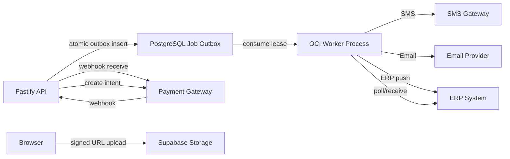

# CareOS — Integration Architecture

**Version:** 1.0.0-draft  
**Status:** Approved for Implementation  
**Last Updated:** 2026-11-14

---

## 1. Integration Philosophy

CareOS integrates with external services through **typed connector abstractions**. Each connector defines a standard interface; the concrete implementation is selected at runtime by configuration. This enables:
- Swapping providers without changing business logic
- Tenant-specific provider selection
- Isolated unit testing of integration logic

All integrations are **asynchronous** where possible — the API enqueues work, the worker executes it, reducing API response latency and improving fault isolation.

---

## 2. Integration Map



---

## 3. SMS Gateway

### Interface

```typescript
interface SmsConnector {
  send(params: {
    to: string;          // E.164 format
    body: string;        // Max 160 chars for single SMS
    tenantId: string;    // For billing attribution
  }): Promise<{ messageId: string; status: 'queued' | 'sent' }>;
}
```

### Supported Providers

| Provider | Adapter Key | Notes |
|---|---|---|
| Twilio | `twilio` | Default; broad coverage |
| Vonage (Nexmo) | `vonage` | Alternative; regional preference |
| Local Gateway | `local_smtp_sms` | For development/testing only |

### Configuration

Stored in `tenant.settings.sms_provider` and `integration.config` (encrypted). Falls back to platform default if tenant has no specific SMS integration.

### Delivery Tracking

Delivery receipts are received via webhook (`POST /api/v1/webhooks/sms/:provider`) and update the `notifications` table.

---

## 4. Email Provider

### Interface

```typescript
interface EmailConnector {
  send(params: {
    to: string | string[];
    subject: string;
    htmlBody: string;
    textBody: string;
    fromName?: string;
    fromAddress?: string;
    attachments?: Attachment[];
    tenantId: string;
  }): Promise<{ messageId: string }>;
}
```

### Supported Providers

| Provider | Adapter Key | Notes |
|---|---|---|
| Resend | `resend` | Default; developer-friendly API |
| SMTP | `smtp` | Generic SMTP fallback |
| Sendgrid | `sendgrid` | Optional enterprise alternative |

### Template Rendering

Email templates are stored as Handlebars (`.hbs`) files per tenant locale. The API service renders the template before passing the HTML to the connector. Template overrides per tenant are stored in `notification_templates` table.

---

## 5. Payment Gateway

### Interface

```typescript
interface PaymentConnector {
  createPaymentIntent(params: {
    amount: number;        // In smallest currency unit (fils/piastres/cents)
    currency: string;      // ISO 4217
    invoiceId: string;
    customerEmail: string;
    metadata: Record<string, string>;
  }): Promise<{ intentId: string; clientSecret: string }>;

  capturePayment(intentId: string): Promise<{ status: 'succeeded' | 'failed' }>;

  refund(params: {
    paymentId: string;
    amount?: number;       // Partial refund amount; full if omitted
    reason: string;
  }): Promise<{ refundId: string }>;
}
```

### Supported Providers

| Provider | Adapter Key | Notes |
|---|---|---|
| Stripe | `stripe` | Default international |
| Tap Payments | `tap` | GCC regional preference |
| PayTabs | `paytabs` | Alternative GCC |

### Webhook Flow

```
Payment Gateway
   │
   ├── POST /api/v1/webhooks/payment/:provider
   │   (signature verified)
   │
   └── PostgreSQL outbox job: "payment:process_webhook"
         │
         ├── Update payment status
         ├── Update invoice status
         ├── Update ticket status (→ resolved if applicable)
         └── Send confirmation notification to customer
```

### On-Site Payment (Technician)

Technicians can record cash or terminal payment using the Technician Portal. This creates a `payment` record with `method: 'cash'` or `method: 'card_terminal'` and triggers the same downstream flow (but without gateway webhook — the technician confirms directly).

---

## 6. ERP Integration

### Interface

```typescript
interface ErpConnector {
  pushInvoice(invoice: Invoice): Promise<{ erpReference: string }>;
  pushCustomer(customer: CustomerAccount): Promise<{ erpCustomerId: string }>;
  pullCustomer(erpCustomerId: string): Promise<Partial<CustomerAccount>>;
  checkConnection(): Promise<{ connected: boolean; version?: string }>;
}
```

### Integration Patterns

**Outbound (CareOS → ERP):** Triggered after payment confirmation or invoice issuance. The worker enqueues an `erp:push_invoice` job. If the push fails, it retries with exponential backoff (max 5 attempts). Failed jobs are moved to a dead-letter queue and alert the tenant admin.

**Inbound (ERP → CareOS):** Customer and billing data synchronisation. The worker polls the ERP on a configurable schedule (e.g., nightly). Pull-based sync preferred to avoid webhook complexity on the ERP side.

### Supported ERP Adapters (v1)

| System | Adapter Key | Sync Direction |
|---|---|---|
| Generic REST | `rest_generic` | Configurable |
| Oracle NetSuite | `netsuite` | Outbound invoices |
| SAP (REST API) | `sap_rest` | Outbound invoices, inbound customers |

---

## 7. Push Notifications (In-App / Web Push)

Supabase Realtime channels are used for in-app notifications in the Operations and Technician portals. The client subscribes to a channel keyed by `tenant_id` + `user_id`.

For web push notifications (progressive web app — Technician Portal), the Web Push API (via service worker) is used. Push subscription tokens are stored in `push_subscriptions` table.

```
Worker
  │
  ├── Realtime NOTIFY (Postgres NOTIFY → Supabase Realtime)
  │   "new_job_assigned" → Technician Portal
  │
  └── Web Push (via push connector)
      → Service worker on technician's device
```

---

## 8. Supabase Storage

Evidence files, signed documents, and quotation PDFs are stored in Supabase Storage.

### Bucket Structure

```
{tenant_id}/
  evidence/
    {work_order_id}/
      {file_id}.jpg
  documents/
    contracts/
      {contract_id}.pdf
    quotations/
      {quotation_id}.pdf
  signatures/
    {work_order_id}/
      signature.png
```

### Access Control

- **Write:** Technicians can upload to their own WO's evidence path; API service account can write anywhere within tenant bucket
- **Read (private):** All reads go through signed URLs generated by the API (time-limited: 1 hour default)
- **Read (public):** No public buckets in v1

---

## 9. Outbound Webhook (Tenant-Configured)

Tenants can configure outbound webhooks to receive real-time events in their own systems.

| Event | Payload |
|---|---|
| `ticket.created` | Ticket summary |
| `ticket.status_changed` | Old + new status, ticket ID |
| `work_order.assigned` | WO + technician + scheduled time |
| `payment.confirmed` | Invoice + payment details |
| `complaint.escalated` | Complaint summary |

Webhook delivery:
- Signed with HMAC-SHA256 (tenant-specific secret)
- Retried 3 times with 1m/5m/30m backoff on non-2xx responses
- Failed deliveries logged to `webhook_delivery_log`

---

## 10. Integration Configuration Security

- All credentials (API keys, client secrets, SMTP passwords) stored in `integrations.config` as encrypted JSONB
- Encryption key stored in environment variable (not in database)
- Credentials are **never** returned in API responses (masked with `***`)
- Credential rotation requires re-entry through the Operations Portal integration settings
- Integration config access is restricted to `tenant_admin` role only

---

## 11. Error Handling and Observability

| Scenario | Handling |
|---|---|
| SMS delivery failure | Retry 3x; mark notification `failed`; alert tenant admin |
| Email bounce | Update delivery status; no retry (bounce = permanent failure) |
| Payment webhook duplicate | Idempotency check on `gateway_reference`; skip if already processed |
| ERP push failure | Dead-letter queue after 5 retries; alert tenant admin |
| Webhook delivery failure | Log to `webhook_delivery_log`; retry per schedule |

All integration job executions are logged with:
- Job ID
- Tenant ID
- Attempt number
- Duration
- Success/failure + error message
