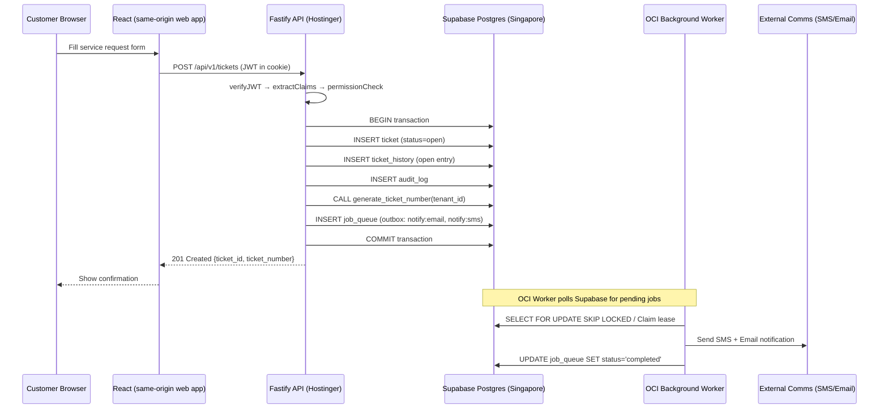

# CareOS — System Architecture

**Version:** 1.1.0-draft  
**Status:** Approved for Implementation  
**Last Updated:** 2026-11-15

---

## 1. Architecture Overview

CareOS is a **monorepo, multi-tenant SaaS application** built on a modern JavaScript/TypeScript stack with Supabase as the managed backend services layer.

### 1.1 Hosting Split

```
┌─────────────────────────────────────────────────────────────────────┐
│       HOSTINGER (Managed Node.js Application — Dynamic Same-Origin) │
│                                                                     │
│   Fastify Dynamic Server (reads process.env.PORT)                   │
│   ├── Serves Built React/Vite SPA (static files + SPA fallback)    │
│   │   /operations   /technician   /customer   /admin               │
│   └── Serves API endpoints (/api/v1/*, /api/health)                │
│                                                                     │
│   Zero CORS overhead · Single origin: https://<OWNER_DOMAIN>        │
└──────────────────────────┬──────────────────────────────────────────┘
                           │  Database transactions & Outbox writes
┌──────────────────────────▼──────────────────────────────────────────┐
│             SUPABASE CLOUD (Singapore: ap-southeast-1)              │
│               Project URL: vbckrirksziluvwqpamx.supabase.co         │
│                                                                     │
│   PostgreSQL 15 (RLS on all tenant tables + job_queue outbox table) │
│   Supabase Auth (JWT issuance, session management, custom claims)   │
│   Storage (private buckets: evidence, documents, PDFs)             │
│   Realtime (live ticket status push directly to browser)            │
└──────────────────────────▲──────────────────────────────────────────┘
                           │  Outbox polling (atomic leases / SKIP LOCKED)
┌──────────────────────────┴──────────────────────────────────────────┐
│          OCI ALWAYS FREE ARM64 COMPUTE (Docker Compose)             │
│                                                                     │
│   Background Worker Container Only (outbound connections only)      │
│   ├── SLA breach checker                                            │
│   ├── Notification sender (email, SMS) via connector contracts      │
│   ├── ERP push synchronization                                      │
│   ├── Bulk service request campaign item processor                  │
│   └── Periodic service intelligence aggregations                    │
│                                                                     │
│   No public inbound ports required · No Redis/Kafka in V1           │
└──────────────────────────┬──────────────────────────────────────────┘
                           │
┌──────────────────────────▼──────────────────────────────────────────┐
│                      External Services                              │
│                                                                     │
│   SMS Gateway      Email (SMTP/API)     Payment Gateway             │
│   ERP Systems      Telematics Platforms  Push Notifications         │
└─────────────────────────────────────────────────────────────────────┘
```

### 1.2 Data Flow Rule

> **Browser → HTTPS to Hostinger Node.js (`https://<OWNER_DOMAIN>`) → Fastify API → Supabase Cloud**
>
> 1. The browser talks directly to the same-origin Fastify server on Hostinger (`/api/v1/*`).
> 2. Fastify validates the user's Supabase JWT and enforces tenant, customer-account, and role authorization.
> 3. Fastify writes business entities and async job records into Supabase PostgreSQL within the same atomic transaction.
> 4. The OCI Background Worker polls Supabase for pending outbox jobs and claims them atomically using row-level leases.
> 5. Live status updates to the browser are streamed directly via Supabase Realtime subscriptions.
> 6. Never trust tenant IDs, user IDs, prices, coverage decisions, or permissions supplied by the browser.

---

## 2. Monorepo Structure

```
careos/
├── apps/
│   ├── web/                    # React/Vite — all portal UIs (deployed to Hostinger as static build)
│   │   ├── src/
│   │   │   ├── portals/
│   │   │   │   ├── customer/   # Customer portal shell + routes (/customer)
│   │   │   │   ├── operations/ # Operations portal shell + routes (/operations)
│   │   │   │   ├── technician/ # Technician portal shell + routes (/technician)
│   │   │   │   └── admin/      # Platform admin shell + routes (/admin)
│   │   │   ├── components/     # Shared UI components (design system)
│   │   │   └── lib/            # Shared web utilities
│   │   └── vite.config.ts
│   │
│   ├── api/                    # Fastify API server (deployed to OCI ARM64 via Docker)
│   │   ├── src/
│   │   │   ├── plugins/        # Fastify plugins (auth, db, cors)
│   │   │   ├── routes/         # Route definitions by domain
│   │   │   ├── services/       # Business logic services
│   │   │   ├── middleware/      # Auth, tenant, permission guards
│   │   │   └── workers/        # Outbox job payload definitions
│   │   └── Dockerfile          # linux/arm64 target
│   │
│   └── worker/                 # Background worker process (deployed to OCI ARM64 via Docker)
│       ├── src/
│       │   ├── jobs/            # Job handler implementations
│       │   ├── schedulers/      # Cron job definitions (SLA checker, report generator)
│       │   └── processors/      # Queue consumers
│       └── Dockerfile           # linux/arm64 target
│
├── packages/
│   ├── shared-types/            # TypeScript interfaces, enums, DTOs
│   ├── shared-utils/            # Date, currency, validation helpers
│   ├── supabase-client/         # Configured Supabase client factory (browser + server)
│   ├── coverage-engine/         # Coverage determination logic (pure TS — no DB access)
│   ├── numbering/               # Ticket/WO reference number formatting
│   ├── permissions/             # Role-permission matrix (source of truth)
│   ├── ui/                      # Design system components (Radix UI + Tailwind CVA)
│   ├── core-domain/             # Pure domain logic and business rules
│   ├── database/                # Kysely types (generated from migrations) + query helpers
│   ├── auth/                    # Auth utilities for server-side use only (never browser)
│   ├── validation/              # Zod schemas for request/response — shared API + frontend
│   ├── integration-contracts/   # Typed connector interfaces (ERP, telematics, payment, comms)
│   └── configuration/           # Env-var Zod schemas + parseEnv() with startup validation
│
├── connectors/
│   ├── sms/                     # SMS gateway abstraction (Twilio stub)
│   ├── email/                   # Email provider abstraction (Resend stub)
│   ├── payment/                 # Payment gateway abstraction (Stripe stub)
│   ├── erp/                     # Generic REST ERP connector
│   └── telematics/              # Generic webhook + REST telematics connector
│
├── supabase/
│   ├── migrations/              # Version-controlled SQL migration files
│   ├── seed/                    # Development seed data (clearly labelled fixtures only)
│   ├── functions/               # Supabase Edge Functions (custom JWT claims hook)
│   ├── tests/                   # Automated SQL/RLS tests
│   └── config.toml              # Local Supabase CLI config
│
├── deployment/
│   ├── hostinger/               # Static frontend upload instructions
│   │   └── README.md
│   ├── oci/                     # OCI ARM64 VM setup and Docker Compose
│   │   └── README.md
│   ├── supabase/                # Supabase Cloud production setup
│   │   └── README.md
│   └── ENVIRONMENT_VARIABLES.md # All env vars documented (no secrets)
│
├── tests/
│   ├── unit/                    # Package-level unit tests (also in packages/*/__tests__)
│   ├── integration/             # API integration tests (Supertest + Vitest)
│   └── e2e/                     # Playwright cross-portal end-to-end tests
│
├── docker/
│   └── docker-compose.yml       # Local development (Redis + API + Worker)
│
├── docs/                        # All architecture documentation
└── package.json                 # Workspace root (pnpm workspaces)
```

---

## 3. Technology Decisions

| Layer | Technology | Rationale |
|---|---|---|
| Package manager | **pnpm** workspaces | Fast, disk-efficient monorepo support |
| Frontend framework | **React 18** + **Vite** | Fast HMR, broad ecosystem, team familiarity |
| Frontend language | **TypeScript 5** | Type safety across monorepo |
| Routing | **React Router v6** | Nested layouts, data loaders |
| State management | **Zustand** (global) + React Query (server state) | Minimal boilerplate; cache-first API data |
| API framework | **Fastify v4** | High throughput, plugin ecosystem, TypeScript-first |
| API language | **TypeScript** (Node.js 20 LTS) | Shared types with frontend |
| Background jobs | **PostgreSQL Outbox Queue** | ACID transactions with business writes; no Redis in V1 |
| Database | **PostgreSQL 15** (Supabase Cloud Singapore) | ACID, RLS, full-text search, confirmed Singapore region |
| Auth | **Supabase Auth** | JWT issuance, session mgmt, OAuth providers |
| File storage | **Supabase Storage** | Evidence photos, signed documents |
| Realtime | **Supabase Realtime** | Ticket status push to customer and ops portals |
| ORM / query builder | **Kysely** | Typesafe SQL, works with Supabase Postgres |
| Testing (unit) | **Vitest** | Native Vite integration |
| Testing (integration) | **Supertest** + **Vitest** | API endpoint testing |
| Testing (E2E) | **Playwright** | Cross-browser, CI-friendly |
| Linting | **ESLint** + **Prettier** | Consistent code style |
| CI/CD | **GitHub Actions** | Monorepo-aware pipeline |
| Dynamic Web / API Hosting | **Hostinger Managed Node.js** | Same-origin Fastify serving React build + `/api/v1` on `process.env.PORT` |
| Worker Hosting | **OCI Always Free** ARM64 (A1 Flex) | linux/arm64 Docker Compose; background worker only (outbound) |

---

## 4. Data Flow: Ticket Creation (Primary Flow)



---

## 5. Authentication Architecture

### 5.1 Browser → Supabase Auth

```
Browser                     Supabase Auth
  │                              │
  ├── POST /auth/v1/token ──────►│
  │   {email, password}          │
  │                              ├── Verify credentials
  │                              ├── Issue JWT (RS256)
  │◄── {access_token,           │
  │     refresh_token} ─────────│
  │                              │
  │   Set httpOnly cookie        │
  │   (access_token)             │
```

### 5.2 Browser → API

```
Browser                     Fastify API               Supabase DB
  │                              │                        │
  ├── GET /api/v1/tickets ──────►│                        │
  │   Cookie: access_token       │                        │
  │                              ├── verifyJWT()          │
  │                              ├── extractClaims()      │
  │                              │   {tenant_id, role}    │
  │                              ├── permissionCheck()    │
  │                              │                        │
  │                              ├── query(tickets) ─────►│
  │                              │   set JWT as role      │
  │                              │                        ├── RLS CHECK
  │                              │                        │   tenant_id match
  │                              │◄── rows ──────────────│
  │◄── 200 JSON ────────────────│                        │
```

### 5.3 JWT Claims Structure

```json
{
  "sub": "user-uuid",
  "aud": "authenticated",
  "exp": 1234567890,
  "iat": 1234564290,
  "email": "user@example.com",
  "app_metadata": {
    "tenant_id": "tenant-uuid",
    "role": "dispatcher",
    "portal": "operations"
  },
  "user_metadata": {
    "full_name": "Ahmed Al-Rashid"
  }
}
```

Custom claims are set via a Supabase Auth hook (database function) that reads the user's role from the `tenant_users` table at login time.

---

## 6. Row-Level Security Architecture

All tenant-data tables enforce RLS. The pattern is:

```sql
-- Enable RLS on every tenant-scoped table
ALTER TABLE tickets ENABLE ROW LEVEL SECURITY;

-- Tenants can only see their own records
CREATE POLICY "tenant_isolation" ON tickets
  USING (tenant_id = (current_setting('request.jwt.claims', true)::json->>'tenant_id')::uuid);

-- Customers can only see their own tickets
CREATE POLICY "customer_own_tickets" ON tickets
  FOR SELECT
  USING (
    tenant_id = (current_setting('request.jwt.claims', true)::json->>'tenant_id')::uuid
    AND (
      -- Ops/admin can see all within tenant
      (current_setting('request.jwt.claims', true)::json->'app_metadata'->>'role') IN ('tenant_admin','tenant_manager','dispatcher','csr','billing_agent','readonly_ops')
      OR
      -- Customers see their own
      customer_account_id = (current_setting('request.jwt.claims', true)::json->>'sub')::uuid
    )
  );
```

The API sets the JWT as the Postgres role session variable before every query, so RLS policies have access to claim values.

---

## 7. Realtime Architecture

Supabase Realtime is used for:
- **Ticket status updates** → pushed to Customer Portal and Operations Portal
- **New job assignments** → pushed to Technician Portal

Clients subscribe to Realtime channels scoped by `tenant_id` and `ticket_id` or `work_order_id`. The API publishes to Realtime via Postgres NOTIFY (via trigger) on state transitions.

---

## 8. Deployment Architecture

```
Internet (HTTPS)
   │
   ├──► Hostinger Managed Node.js Application (https://<OWNER_DOMAIN>)
   │     │  (Reads process.env.PORT automatically)
   │     ├──► Built React/Vite SPA (Fastify static file handler + SPA fallback)
   │     │      /operations   /technician   /customer   /admin
   │     │
   │     └──► Fastify API Routes (/api/v1/*, /api/health)
   │           │
   │           └──► Supabase Cloud (Singapore: ap-southeast-1)
   │                 ├── Postgres 15 (RLS on all tables + job_queue outbox table)
   │                 ├── Auth (JWT verification & custom claims)
   │                 ├── Storage (private evidence buckets)
   │                 └── Realtime (WebSocket status updates directly to browser)
   │
   └──► OCI Always Free ARM64 Compute (Docker Compose)
         │  (Outbound-only connectivity to Supabase Cloud)
         │
         └──► CareOS Worker Container (polls job_queue via atomic lease locks)
               ├── SLA checks & breach alerts
               ├── Email & SMS notification dispatch
               ├── ERP push synchronization
               └── Bulk service request item processing
```

**Hosting Split Summary:**
- **Hostinger:** Serves the dynamic same-origin application (React SPA + Fastify API) on the assigned `PORT`. No separate API subdomain, no VPS required.
- **OCI (ARM64):** Runs the background worker container only via Docker Compose. No public inbound ports required.
- **Supabase Cloud:** Managed platform in Singapore (`ap-southeast-1`), project reference `vbckrirksziluvwqpamx`.
- **Local Development:** Supabase CLI starts a local Supabase stack (`supabase start`). Fastify API runs on port 3000, Vite dev server on port 5173 (proxying `/api` to port 3000), and worker runs locally.

---

## 9. Scaling Considerations (v1 → v2 path)

| Concern | v1 Approach | v2 Path |
|---|---|---|
| API scaling | Single instance + vertical | Horizontal (stateless, sticky sessions in Redis) |
| Worker scaling | Single instance | Multiple workers per queue |
| DB connections | Supabase connection pooler (PgBouncer) | Same; tune pool size |
| File storage | Supabase Storage | Same; optionally move to object store |
| Search | Postgres full-text | pg_vector or dedicated search |
