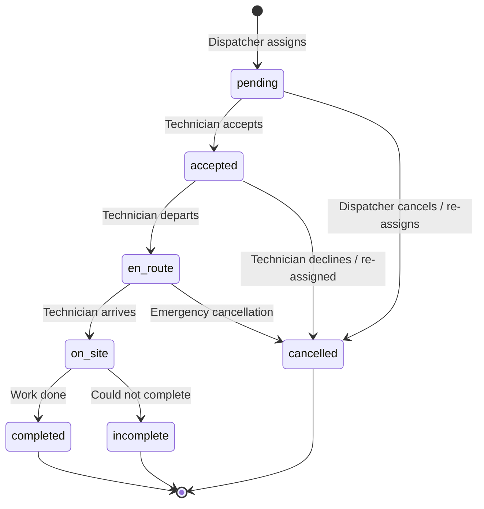
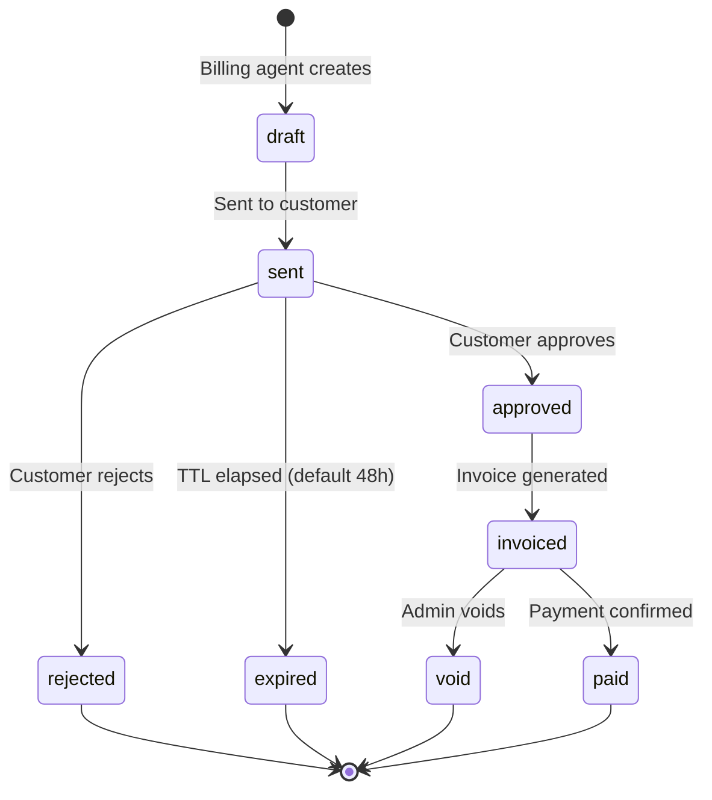
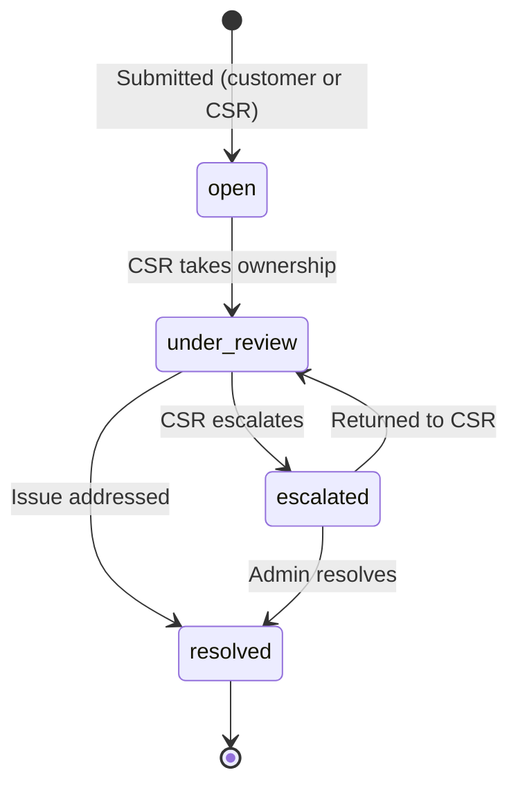

# CareOS — Service Lifecycle and Status Model

**Version:** 1.0.0-draft  
**Status:** Approved for Implementation  
**Last Updated:** 2026-11-14

---

## 1. Ticket State Machine

A **Ticket** is the master record for a customer service request. It persists from first contact through final resolution and payment.

### 1.1 States

| State | Meaning | Visible to Customer? |
|---|---|---|
| `draft` | Created but not submitted (Customer Portal save-and-continue) | Yes (own draft only) |
| `open` | Submitted; awaiting triage | Yes |
| `triaged` | CSR has reviewed; coverage determined | Yes |
| `scheduled` | Work order created and technician assigned | Yes |
| `in_progress` | Technician has checked in on-site | Yes |
| `awaiting_customer` | Blocked on customer decision (quote approval, access, parts) | Yes |
| `awaiting_parts` | Blocked on parts procurement | Partial (shows "pending parts") |
| `awaiting_payment` | Work done; awaiting final payment | Yes |
| `resolved` | Work complete and paid (or warranty/free) | Yes |
| `closed` | Administratively closed (no work possible / cancelled) | Yes |
| `reopened` | Customer re-raised after resolution | Yes |

### 1.2 Ticket State Machine Diagram

```mermaid
stateDiagram-v2
    [*] --> draft : Customer starts request
    draft --> open : Customer submits
    draft --> [*] : Customer deletes draft

    open --> triaged : CSR triages
    open --> closed : CSR cancels (spam/duplicate)

    triaged --> scheduled : Dispatcher assigns WO
    triaged --> awaiting_customer : Needs customer input
    triaged --> closed : Customer cancels

    awaiting_customer --> triaged : Customer responds
    awaiting_customer --> closed : No response / cancelled

    scheduled --> in_progress : Technician checks in
    scheduled --> awaiting_customer : Access issue
    scheduled --> awaiting_parts : Parts needed first

    awaiting_parts --> scheduled : Parts received
    awaiting_parts --> closed : Cannot source parts

    in_progress --> awaiting_customer : Needs approval (quote)
    in_progress --> awaiting_parts : Additional parts needed
    in_progress --> awaiting_payment : Work done; payment pending
    in_progress --> resolved : No charge (warranty/free/contract)

    awaiting_customer --> in_progress : Customer approves
    awaiting_customer --> closed : Customer rejects

    awaiting_payment --> resolved : Payment confirmed
    awaiting_payment --> closed : Payment failed / abandoned

    resolved --> reopened : Customer raises issue within reopen window
    closed --> open : Admin re-opens (audit-logged)
    reopened --> scheduled : New WO dispatched
    reopened --> closed : Duplicate/invalid reopen
    resolved --> [*]
    closed --> [*]
```



### 1.3 Allowed Transitions by Role

| Transition | `tenant_admin` / `tenant_manager` | `dispatcher` | `csr` | `technician` | `customer_*` |
|---|---|---|---|---|---|
| draft → open | — | — | — | — | ✅ |
| open → triaged | ✅ | ✅ | ✅ | — | — |
| open → closed | ✅ | ✅ | ✅ | — | ✅ (own) |
| triaged → scheduled | ✅ | ✅ | — | — | — |
| triaged → awaiting_customer | ✅ | ✅ | ✅ | — | — |
| scheduled → in_progress | ✅ | ✅ | — | ✅ | — |
| in_progress → awaiting_customer | ✅ | ✅ | — | ✅ | — |
| in_progress → awaiting_parts | ✅ | ✅ | — | ✅ | — |
| in_progress → awaiting_payment | ✅ | ✅ | — | ✅ | — |
| in_progress → resolved | ✅ | ✅ | — | ✅ | — |
| awaiting_customer → in_progress | ✅ | ✅ | — | — | ✅ (approve quote) |
| awaiting_customer → closed | ✅ | ✅ | ✅ | — | ✅ (reject quote) |
| awaiting_payment → resolved | ✅ | — | — | ✅ | ✅ (online pay) |
| resolved → reopened | ✅ | ✅ | ✅ | — | ✅ (within window) |
| closed → open | ✅ | — | — | — | — |
| Any → closed (admin force) | ✅ | — | — | — | — |

> **Reopen window:** Configurable per tenant (default: 30 days from `resolved`). After the window, customers must open a new ticket.

---

## 2. Work Order State Machine

A **Work Order** (WO) is the operational unit tied to one ticket visit. A ticket may have multiple sequential work orders (e.g., initial visit, return visit after parts arrive).

### 2.1 States

| State | Meaning |
|---|---|
| `pending` | WO created; technician notified |
| `accepted` | Technician acknowledged the assignment |
| `en_route` | Technician marked themselves travelling |
| `on_site` | Technician checked in at customer location |
| `completed` | Technician marked work done |
| `incomplete` | Visit occurred but work could not be completed |
| `cancelled` | WO cancelled before visit |

### 2.2 Work Order State Diagram



### 2.3 WO → Ticket Status Linkage

| WO Event | Ticket Transition |
|---|---|
| WO created | ticket → `scheduled` |
| WO `on_site` | ticket → `in_progress` |
| WO `completed` (no charge) | ticket → `resolved` |
| WO `completed` (charge pending) | ticket → `awaiting_payment` |
| WO `incomplete` | ticket → `awaiting_parts` or `awaiting_customer` |
| WO `cancelled` + no active WO | ticket → `triaged` |

---

## 3. Quotation Lifecycle



- Only one **active** quotation per ticket at a time (others must be `void` or `rejected` before a new one can be `sent`).
- TTL is configurable per tenant (default: 48 hours).
- Customer approval is explicit (button click + timestamp logged, not email reply).

---

## 4. Complaint Lifecycle



- Escalation triggers an email notification to `tenant_admin`.
- Resolved complaints cannot be reopened; a new complaint must be filed.

---

## 5. Coverage Determination Logic

```
Given a new ticket with asset_id (nullable) and report_date:

PHASE 1 — WARRANTY
  If asset_id IS NOT NULL:
    Query warranty records WHERE asset_id = X
      AND starts_at <= report_date AND expires_at >= report_date AND status = 'active'
    → If found: coverage_type = 'warranty', warranty_id = W
    → If multiple found: ambiguous_coverage = true; flag for CSR review

PHASE 2 — CONTRACT (if no warranty match)
  If asset_id IS NOT NULL:
    Query contracts WHERE customer_account_id = X
      AND covers_categories CONTAINS asset.category
      AND starts_at <= report_date AND expires_at >= report_date AND status = 'active'
    → If found: coverage_type = 'contract', contract_id = C
    → If multiple found: ambiguous_coverage = true; flag for CSR review

PHASE 3 — FREE SERVICE (if no warranty or contract match)
  Load all enabled free_service_rules for tenant (ordered by priority ASC)
  For each rule (using current_version_id):
    1. Check effective_from <= report_date AND (effective_until IS NULL OR effective_until >= report_date)
    2. Check eligible_account_types includes customer's account_type
    3. Check eligible_account_ids is NULL OR customer_account_id in list
    4. If asset_id IS NOT NULL:
         Check eligible_asset_categories is NULL OR asset.category in list
         Check eligible_device_categories is NULL OR device.device_type in list (if device attached)
    5. Check eligible_service_categories is NULL OR ticket.category in list
    6. Evaluate conditions (e.g., within_days_of_installation)
    7. Evaluate exclusions (e.g., prior_complaint_within_days)
    8. If max_visits_per_asset IS NOT NULL:
         Count prior free-service tickets for this asset in the visit_period
         → If count >= max_visits_per_asset: rule does not apply

  → First matching rule:
      If rule.requires_approval = true:
        coverage_type = 'pending_review'
        Record free_service_eligibility_decision { is_eligible=true, requires_approval=true, rule_id, explanation }
        Ticket status moves to 'awaiting_customer' (pending approver action)
      Else:
        coverage_type = 'free'
        Record free_service_eligibility_decision { is_eligible=true, requires_approval=false }

  → No rule matches:
      Record free_service_eligibility_decision { is_eligible=false, explanation }

PHASE 4 — PAID (if no coverage found)
  coverage_type = 'paid'

PHASE 5 — PLATFORM TICKETS (asset_id IS NULL)
  Skip warranty and contract phases.
  Free-service rules with eligible_asset_categories = NULL still apply.
  If no rule matches: coverage_type = 'paid'.
```

This logic runs as a pure service function (`packages/coverage-engine`). The API service layer fetches all required data and passes plain objects. No I/O inside the engine.

**Free-service approval flow:**  
When `requires_approval = true`, the system records the pending decision and sets `coverage_type = pending_review`. The configured `approver_role` (or specific `approver_user_id`) receives an in-app notification. On approval, `coverage_type` transitions to `free`; on rejection, it transitions to `paid` and a standard quotation is generated.

---

## 6. SLA State Pausing

SLA clock pauses when ticket enters:
- `awaiting_customer`
- `awaiting_parts`

SLA clock resumes when ticket leaves those states.

SLA breach is evaluated by a background worker that runs every 5 minutes and compares `now()` against computed deadlines factoring in pause periods.

---

## 7. Evidence and Audit Trail

Every state transition creates an immutable record in `ticket_history` and `audit_log`:

```
{
  entity_type: "ticket",
  entity_id: "...",
  from_state: "triaged",
  to_state: "scheduled",
  actor_id: "...",
  actor_role: "dispatcher",
  tenant_id: "...",
  occurred_at: "2026-01-14T10:00:00Z",
  metadata: { work_order_id: "...", technician_id: "..." }
}
```

Audit log records are append-only. No application code or role may update or delete an audit_log row (enforced via RLS: `USING (false)` for UPDATE/DELETE).
